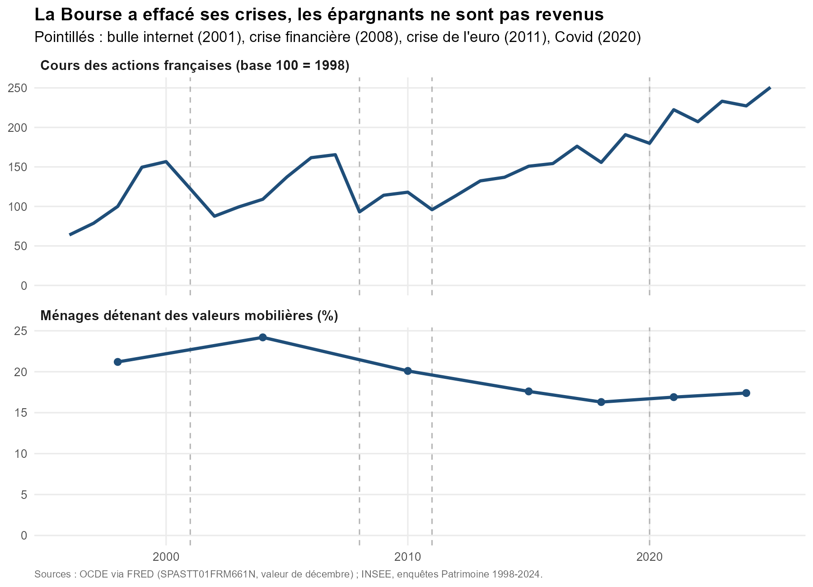
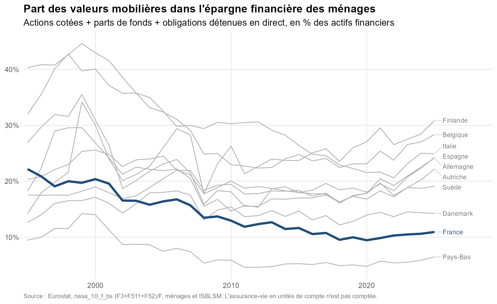
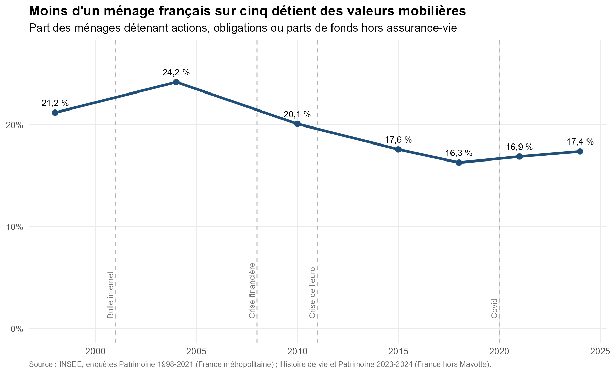
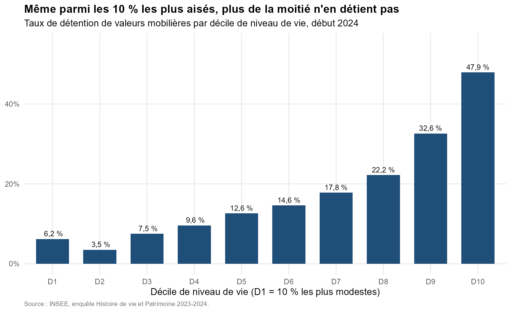
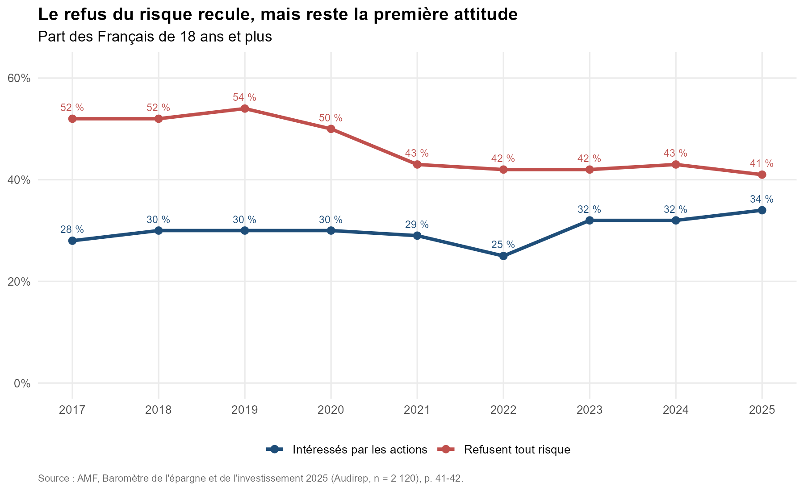

# La défiance des ménages français envers les valeurs mobilières jugées à risque

Pourquoi les Français, à revenu comparable, détiennent-ils si peu d'actions, d'obligations et de parts de fonds ?
Ce projet reprend une hypothèse de recherche de licence et la confronte aux données publiques.



## Résultats

1. **La France est l'avant-dernière d'Europe** (10 pays, Eurostat 1995-2025). Les valeurs mobilières détenues en direct
   représentent 10,9 % de l'épargne financière des ménages français en 2025, contre 24 % en Allemagne et 28 % en Belgique.
   À PIB par habitant et année donnés, la France se situe **7,9 points sous les autres pays** (p < 0,01).
2. **La détention recule depuis 20 ans** (INSEE) : 24,2 % des ménages en 2004, 17,4 % en 2024.
   Le recul suit la bulle internet, la crise de 2008 et la crise de l'euro, sans rattrapage depuis.
3. **Le revenu n'explique pas tout** : même parmi les 10 % les plus aisés, 52 % des ménages ne détiennent aucune valeur mobilière.
4. **La perception du risque reste dominante** (AMF 2025) : 41 % des Français refusent tout risque,
   68 % jugent les actions « trop risquées » et 73 % les estiment « réservées à ceux qui s'y connaissent ».
5. **Les crises laissent une trace durable**. Les cours des actions françaises ont été multipliés par 2,5 depuis 1998
   et ont effacé chaque krach. La part des ménages détenteurs, elle, est passée de 24 % (2004) à 17 % (2024)
   et n'est jamais remontée.

## Ce que dit la série temporelle, et ce qu'elle ne dit pas

Sur 27 années de flux (1999-2025, Eurostat), on compare les achats nets des ménages au rendement moyen
de la Bourse française sur les 3 années précédentes (erreurs de Newey-West) :

| Achats nets de… | Corrélation | p-value | Lecture |
|---|---|---|---|
| Parts de fonds | +0,59 | < 0,001 | On achète après les bonnes années, on vend après les mauvaises |
| Actions en direct | -0,50 | 0,008 | Les détenteurs restants achètent quand les cours ont baissé |

Les deux comportements coexistent. La majorité, qui passe par des fonds, se retire après les crises.
Une minorité d'actionnaires en direct, déjà convaincus, profite des baisses. La crise ne fait pas vendre tout le monde,
mais elle réduit le nombre de détenteurs, et ce nombre ne se reconstitue pas.

**Le flou, assumé :**
- Une corrélation n'est pas une causalité. La fiscalité (PEA, flat tax de 2018), les privatisations et les taux d'intérêt
  jouent aussi.
- Les parts de fonds incluent les fonds monétaires, qui sont des placements refuges.
- La série des achats de fonds n'est pas stationnaire au sens du test ADF (p = 0,39), donc sa régression est à lire avec prudence.
- Le lien entre taux de détention et rendements passés ne repose que sur 7 enquêtes INSEE (corrélation 0,42, non significative).
- La relation est cohérente avec l'hypothèse d'une mémoire des crises, mais elle ne la démontre pas.

## Limites

- **L'assurance-vie**. Elle représente 26 % de l'épargne financière des Français. Une partie, les unités de compte,
  est investie en actions. La France détient donc des valeurs mobilières *indirectement*, ce que l'indicateur ne compte pas.
  C'est la principale objection possible.
- **Les fonds de pension**. Aux Pays-Bas et au Danemark, les actions sont détenues par les fonds de pension, ce qui fait baisser leur part.
- **Seulement 10 pays**. Les erreurs groupées par pays reposent sur 10 groupes : la significativité doit être lue avec prudence.
- **Données agrégées**. On ne peut pas isoler l'effet propre de la confiance à revenu, patrimoine et diplôme égaux.
  L'étape suivante utilisera les données individuelles (enquête ELIPSS ou Patrimoine) et un modèle logit.

## Reproduire

```
Rscript analyse.R
```
Le script lit `donnees/` et écrit les graphiques et `resultats.txt` dans `sorties/`.
Packages : readxl, dplyr, tidyr, ggplot2, ggrepel, scales, sandwich, lmtest, tseries.

## Sources

- OCDE, indice des cours des actions France, via [FRED SPASTT01FRM661N](https://fred.stlouisfed.org/series/SPASTT01FRM661N).
- Eurostat, comptes financiers annuels [nasa_10_f_bs](https://ec.europa.eu/eurostat/databrowser/view/nasa_10_f_bs/default/table), flux [nasa_10_f_tr](https://ec.europa.eu/eurostat/databrowser/view/nasa_10_f_tr/default/table) et PIB par habitant [nama_10_pc](https://ec.europa.eu/eurostat/databrowser/view/nama_10_pc/default/table).
- INSEE, [Patrimoine et endettement des ménages en 2024](https://www.insee.fr/fr/statistiques/8736842) et [Taux de détention de patrimoine 1998-2021](https://www.insee.fr/fr/statistiques/7941419).
- AMF, [Baromètre de l'épargne et de l'investissement 2025](https://www.amf-france.org/sites/institutionnel/files/private/2025-12/barometre-amf-2025.pdf), p. 41-42 (séries recopiées dans `donnees/amf_barometre.csv`, le PDF n'est pas versionné).

## Graphiques

| | |
|---|---|
|  |  |
|  |  |
